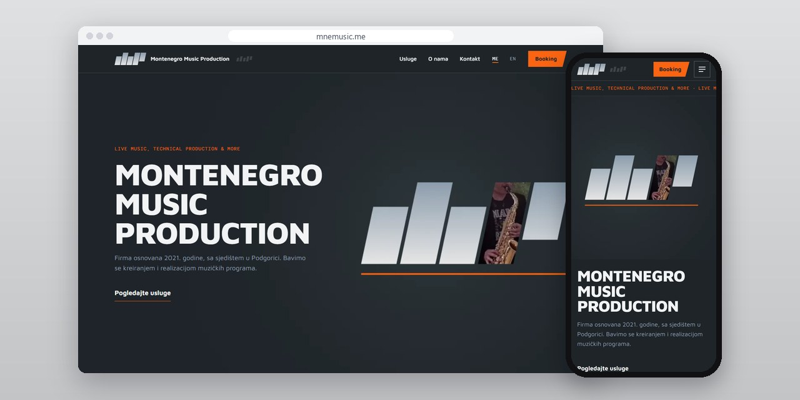
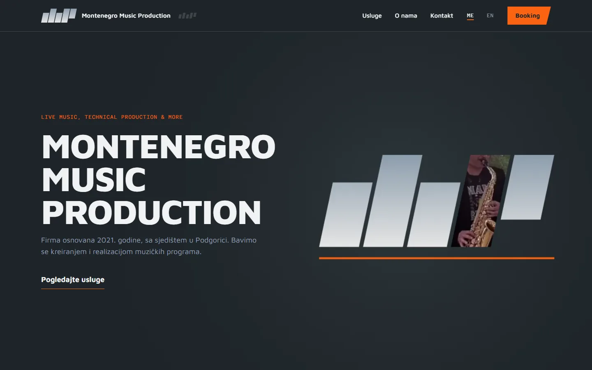
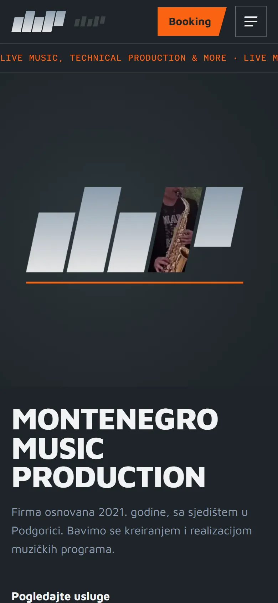
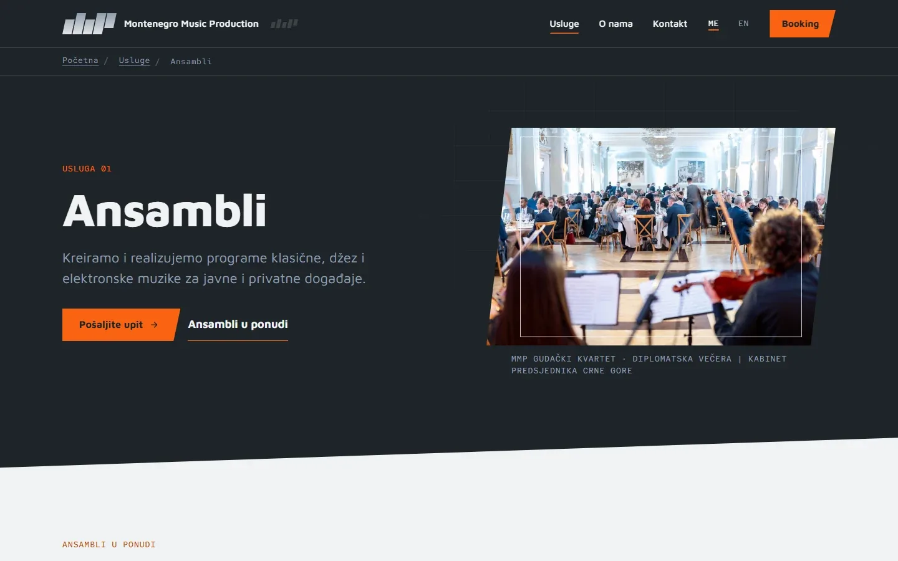
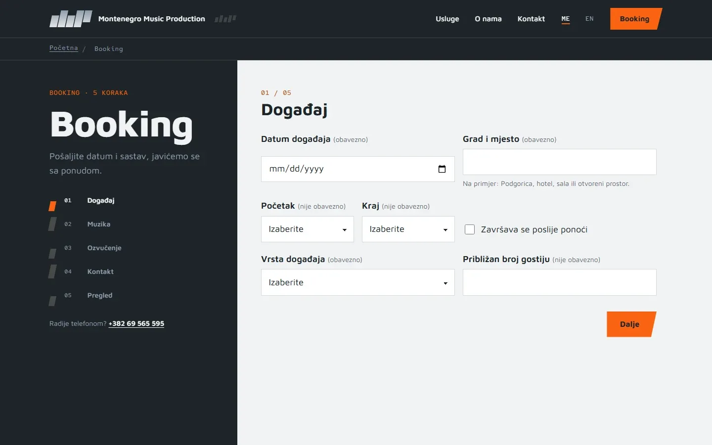

# Montenegro Music Production

A site for a music production company from Podgorica, with 17 ensembles, technical production, a studio and a five-step booking form.

**[mnemusic.me](https://mnemusic.me/)** · [Case study](https://svilenkovic.com/portfolio/montenegro-music-production) · [Srpski](README.sr.md)

> [!NOTE]
> Client project. The source code belongs to the client and stays in a private repository. This page describes what I built and how.

<table>
  <tr><td><b>Client</b></td><td>Montenegro Music Production d.o.o.</td></tr>
  <tr><td><b>Industry</b></td><td>Live music and technical production for events</td></tr>
  <tr><td><b>Location</b></td><td>Podgorica, Montenegro</td></tr>
  <tr><td><b>Type</b></td><td>Bilingual website with a booking form</td></tr>
  <tr><td><b>My role</b></td><td>Redesign, development, SEO and hosting</td></tr>
  <tr><td><b>Stack</b></td><td>Astro 7, TypeScript, AVIF, WebP, JSON-LD</td></tr>
</table>

## About the project

Montenegro Music Production has put together music programs for public and private events since 2021, from solo piano to a chamber orchestra or a DJ with a violin. It also handles the technical production of Festival mladih umjetnika. The site had to show an event organizer what can be booked and make the inquiry easy, with the date, the line-up and the sound system in one form.

The ensembles are grouped by genre: classical from a solo instrument to a chamber orchestra of 7 to 15 strings, jazz from solo to quintet, and electronic, a DJ alone or with violin or saxophone. That makes seventeen line-ups, each with its members listed and an “Add to inquiry” button that carries it into the booking form. The form itself has five short steps: event, music, sound, contact and a review of everything entered before it is sent.

## What I built

- Three service pages: ensembles, technical production and a studio that works in partnership with a studio in Belgrade
- 17 ensembles by genre, each with its line-up and a button that adds it to the booking
- A five-step booking form with date, city, venue, line-up, sound system and outdoor performance
- A list of past clients and events in its own scrolling box, on the home page and the About page
- A dark design with orange and slanted bars taken from the company's logo, and an opening video that moves with scrolling
- 17 pages, 11 in Montenegrin and 6 in English under /en/, with old addresses redirected to the new service pages

## Results

| | Performance | Accessibility | Best practices | SEO |
| :-- | :-: | :-: | :-: | :-: |
| Mobile | 100 | 100 | 100 | 100 |
| Desktop | 100 | 100 | 100 | 100 |

PageSpeed Insights, lab test of the live site, November 2026. Security headers: 6 of 6. axe accessibility check: no violations. Structured data: `EntertainmentBusiness`.

## Screenshots

<table>
  <tr>
    <td width="68%" valign="top"></td>
    <td width="32%" valign="top"></td>
  </tr>
</table>

Service 01, Ensembles: classical, jazz and electronic music for public and private events

Booking in five steps: event, music, sound, contact and review

---

Built by [D. Svilenković](https://svilenkovic.com).
