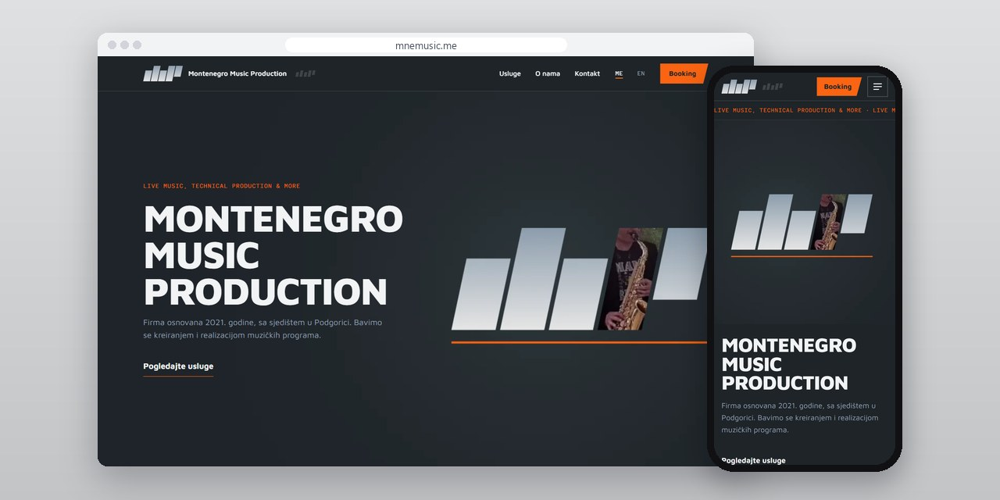
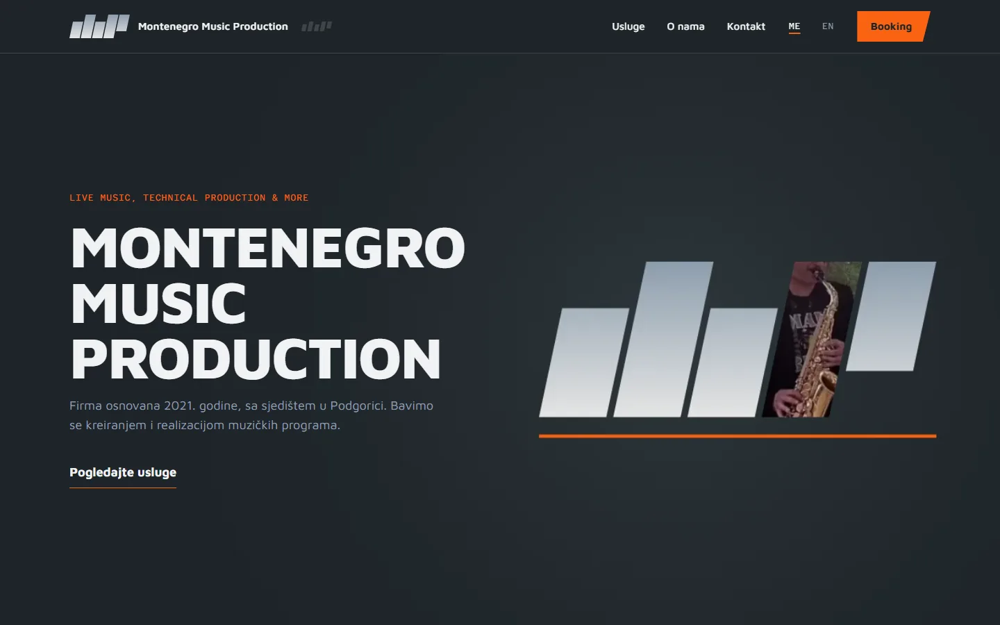
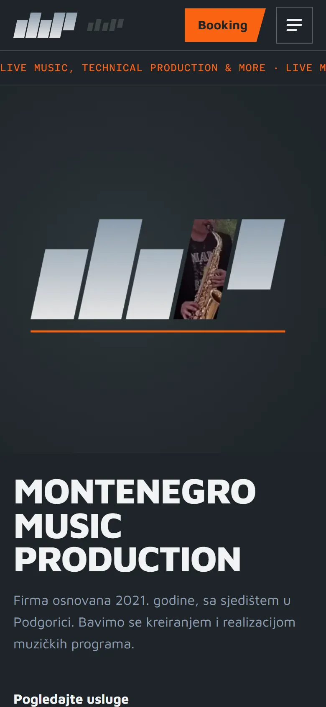
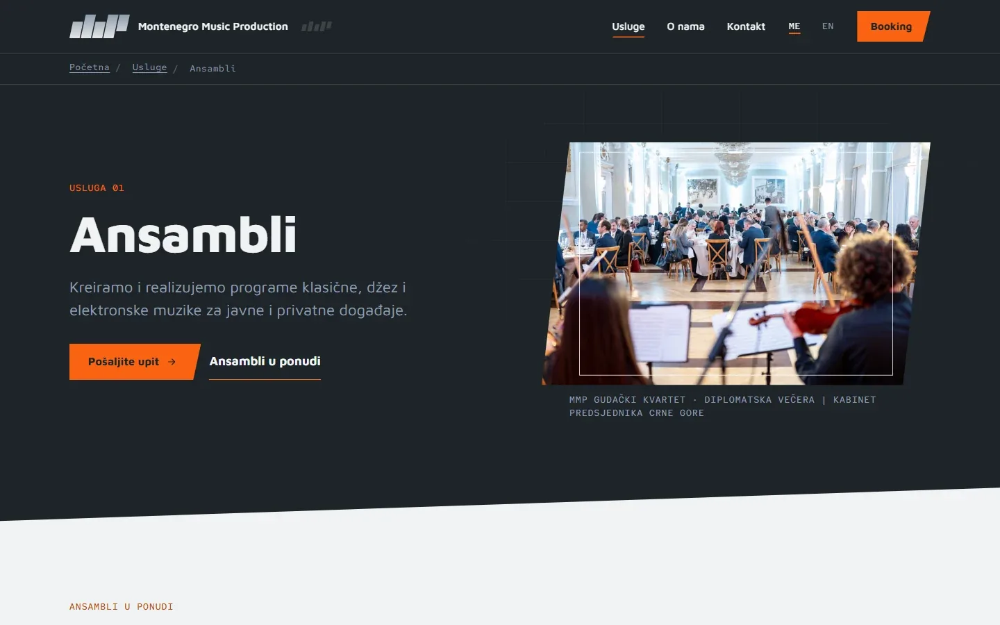
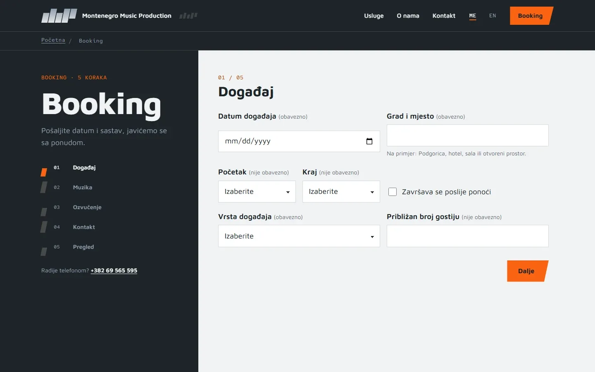

# Montenegro Music Production

Sajt muzičke produkcije iz Podgorice sa 17 ansambala, tehničkom produkcijom, studijom i formom za booking u pet koraka.

**[mnemusic.me](https://mnemusic.me/)** · [Studija slučaja](https://svilenkovic.rs/radovi/montenegro-music-production) · [English](README.md)

> [!NOTE]
> Klijentski projekat. Izvorni kod pripada klijentu i čuva se u privatnom repozitorijumu. Ova stranica opisuje šta sam uradio i kako.

<table>
  <tr><td><b>Klijent</b></td><td>Montenegro Music Production d.o.o.</td></tr>
  <tr><td><b>Delatnost</b></td><td>Muzička i tehnička produkcija događaja</td></tr>
  <tr><td><b>Lokacija</b></td><td>Podgorica, Crna Gora</td></tr>
  <tr><td><b>Vrsta</b></td><td>Dvojezični sajt sa formom za booking</td></tr>
  <tr><td><b>Moj deo posla</b></td><td>Redizajn, izrada, SEO i hosting</td></tr>
  <tr><td><b>Tehnologije</b></td><td>Astro 7, TypeScript, AVIF, WebP, JSON-LD</td></tr>
</table>

## O projektu

Montenegro Music Production od 2021. pravi muzičke programe za javne i privatne događaje, od solo klavira do kamernog orkestra ili DJ-a sa violinom. Radi i tehničku produkciju Festivala mladih umjetnika. Sajt je trebalo da organizatoru događaja pokaže šta može da naruči i da mu olakša upit, sa datumom, sastavom i ozvučenjem u jednoj formi.

Ansambli su podeljeni po žanru: klasika od solo instrumenta do kamernog orkestra od 7 do 15 gudača, džez od solo instrumenta do kvinteta i elektronska muzika, DJ sam ili sa violinom ili saksofonom. Ukupno sedamnaest sastava, uz svaki je navedena postava i dugme „Dodaj u upit” koje ga prenosi u formu za booking. Sama forma ima pet kratkih koraka: događaj, muzika, ozvučenje, kontakt i pregled svega upisanog pre slanja.

## Šta sam uradio

- Tri strane usluga: ansambli, tehnička produkcija i studio koji radi u saradnji sa studiom u Beogradu
- 17 ansambala po žanru, svaki sa postavom i dugmetom koje ga dodaje u booking
- Booking u pet koraka sa datumom, gradom, mestom, sastavom, ozvučenjem i nastupom napolju
- Spisak klijenata i događaja u prozoru sa sopstvenim skrolom, na naslovnoj i na strani O nama
- Taman izgled sa narandžastom bojom i kosim stubićima iz znaka firme i uvodni snimak koji se pomera sa skrolom
- 17 strana, 11 na crnogorskom i 6 na engleskom pod /en/, sa starim adresama preusmerenim na nove strane usluga

## Merenja

| | Performanse | Pristupačnost | Dobre prakse | SEO |
| :-- | :-: | :-: | :-: | :-: |
| Telefon | 100 | 100 | 100 | 100 |
| Desktop | 100 | 100 | 100 | 100 |

PageSpeed Insights, laboratorijsko merenje živog sajta, novembar 2026. Sigurnosna zaglavlja: 6 od 6. axe provera pristupačnosti: bez prekršaja. Strukturisani podaci: `EntertainmentBusiness`.

## Snimci ekrana

<table>
  <tr>
    <td width="68%" valign="top"></td>
    <td width="32%" valign="top"></td>
  </tr>
</table>

Usluga 01, Ansambli: klasika, džez i elektronska muzika za javne i privatne događaje

Booking u pet koraka: događaj, muzika, ozvučenje, kontakt i pregled

---

Izrada: [D. Svilenković](https://svilenkovic.rs).
